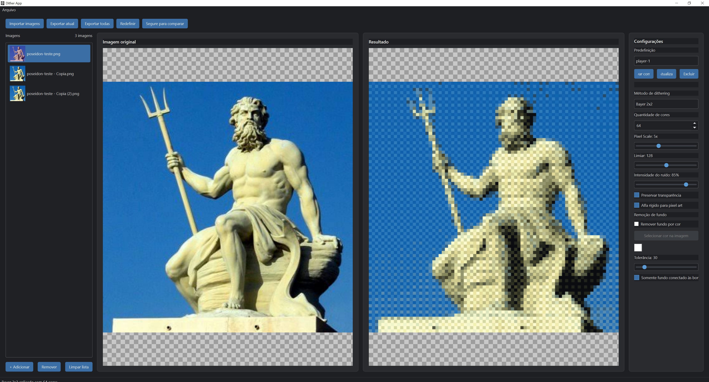
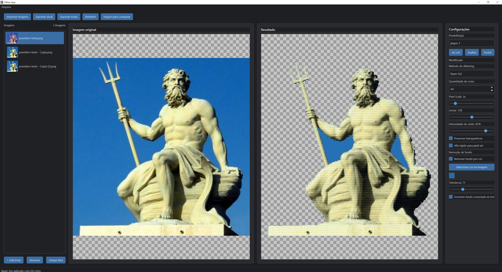

# Dither App

A desktop image-processing application for creating color and pixel-art dithering effects. Dither App combines a live before-and-after preview, transparency controls, color-based background removal, reusable presets, and single-image or batch PNG export.

**Current version:** 0.11.0 Beta  
**Platform:** Windows x64  
**Interface language:** Brazilian Portuguese  
**Copyright:** Tiny Glitch. All rights reserved. See [COPYRIGHT.md](COPYRIGHT.md).

> This repository is published for professional presentation and review. No open-source license is granted. Do not reuse, redistribute, or sell the code or assets without written permission from the rights holder.

## Features

- Compare an original image with its processed result in side-by-side preview panels.
- Apply Threshold, Floyd-Steinberg, Atkinson, Bayer 2x2, 4x4 or 8x8, and seeded Noise dithering, or use no dithering.
- Choose a palette size from 2 to 256 colors for palette-based methods.
- Adjust Pixel Scale from 1x to 12x for a blockier result.
- Preserve alpha transparency or convert it to hard transparent/opaque pixels.
- Remove a selected background color globally or only where it connects to an image edge.
- Save, update, select, and delete named processing presets. The built-in Normal preset is protected.
- Import multiple images, preview each one, and export the list as PNG files.
- Keep the interface responsive during the supported background processing and export tasks.

Supported input formats are PNG, JPG, JPEG, WebP, and BMP. Output is PNG with RGBA support.

## Screenshots

Real screenshots from the running application are included in [assets/screenshots](assets/screenshots). These examples show Pixel Scale and ordered dithering, along with background removal and transparency.

## Algorithms and processing

Threshold maps luminance to black or white using the selected threshold. Floyd-Steinberg uses Pillow's palette quantization and error diffusion. Atkinson distributes quantization error to neighboring pixels. Bayer uses ordered threshold matrices at three sizes. Noise adds seeded RGB noise before mapping pixels to an adaptive palette, so the same settings are repeatable.

Processing uses Pillow and NumPy. Palette-based methods build an adaptive palette from visible pixels. When Pixel Scale is above 1x, the image is reduced with BOX resampling before dithering and enlarged with nearest-neighbor resampling afterward. Background removal runs before that scale and dithering stage.

## Architecture

The application entry point is app.py. The Qt window and most processing algorithms, widgets, and worker classes live in dither_app/main_window.py. Smaller modules provide settings, preset persistence, image I/O, batch-list helpers, resource lookup, and visual styles. Some modules re-export classes or functions from main_window.py for convenient imports.

- dither_app/settings.py defines the immutable processing settings model and Normal defaults.
- dither_app/presets.py validates and persists user presets as JSON.
- dither_app/batch.py prepares batch-list entries, thumbnails, and collision-safe output names.
- dither_app/image_io.py contains image loading and PNG path helpers.
- dither_app/workers.py and dither_app/processing.py expose worker and processing APIs from the main window module.
- tests/ contains unittest coverage for processing, presets, batches, version metadata, and installer configuration.

## Run from source

The project build instructions use Python 3.13 on Windows.

    py -3.13 -m venv .venv
    .\.venv\Scripts\Activate.ps1
    python -m pip install -r requirements.txt
    python app.py

To run the existing test suite, install the development dependency and use the command documented in BUILDING.md:

    python -m pip install -r requirements-dev.txt
    python -m unittest discover -s tests -v

## Build for Windows

Build the portable onedir distribution on Windows:

    python -m pip install -r requirements-dev.txt
    .\build.ps1

The executable and required support files are placed in dist/DitherApp. Distribute the whole folder. The build script runs the existing unittest suite before packaging.

To build the Inno Setup installer, first generate the icon, install Inno Setup 6 or 7, then run:

    python tools\generate_icon.py
    .\build-installer.ps1

The installer is written under release/installer. The installer configuration is not digitally signed. A separate one-file build script is also present at build-onefile.ps1; review BUILDING.md and the script before choosing that distribution.

## Repository setup

Suggested GitHub description:

> Windows desktop app for color dithering, pixel-art effects, transparency control, and batch PNG export.

Suggested topics:

image-processing, dithering, pixel-art, python, pyside6, pillow, numpy, windows, pyinstaller

Before a public release, capture genuine screenshots, confirm the generated icon is available for packaging, review all included assets, and decide whether a commercial license or another rights notice is needed. Do not add an OSI license unless the rights holder intends to make the project open source. See [docs/GITHUB_SETUP.md](docs/GITHUB_SETUP.md) for a publication checklist.

## Roadmap

Ideas for future work, not commitments or claims about current functionality:

- Add a short usage guide and additional release screenshots.
- Add automated Windows build and release workflows.
- Improve reporting of per-file batch failures in the interface.
- Evaluate more palette controls and additional dithering methods.
- Decide on a licensing and commercial distribution model.

## Project documentation

- [Technical and development documentation (Portuguese PDF)](docs/Dither-App-Documentacao-Tecnica-e-de-Desenvolvimento-pt-BR.pdf)
- [GitHub publication checklist](docs/GITHUB_SETUP.md)
- [Screenshot index](assets/screenshots/README.md)
- [Windows build instructions](BUILDING.md)

## Brief overview in Portuguese

O Dither App é um aplicativo desktop para Windows que aplica dithering colorido e efeitos de pixel art. Ele oferece prévia lado a lado, controle de transparência, remoção de fundo por cor, predefinições persistentes e exportação PNG individual ou em lote.

## Copyright and licensing

Copyright (c) 2026 Tiny Glitch. All rights reserved. This project currently has no open-source license. Publication on GitHub is for visibility and review; it does not grant permission to use, modify, redistribute, or commercialize the code or bundled assets. Refer to [COPYRIGHT.md](COPYRIGHT.md).
